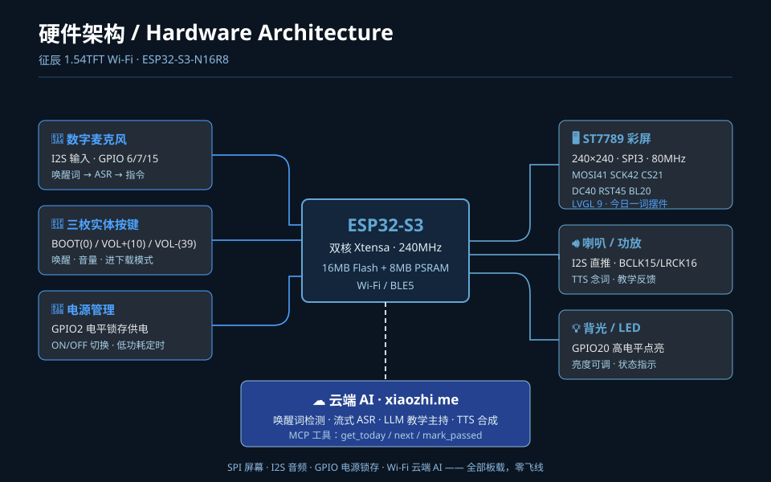

# 硬件资料 / Hardware

## 开发板

征辰科技 1.54 寸 TFT Wi-Fi 开发板，本质上是开源项目 xiaozhi-esp32 官方支持板型 `zhengchen/1.54tft-wifi` 的硬件，出厂预装"小智 AI 语音助手"。

| 项目 | 规格 |
|---|---|
| 主控 | ESP32-S3，双核 Xtensa LX7，最高 240MHz |
| 存储 | 16MB Flash (N16) + 8MB PSRAM (R8) |
| 无线 | Wi-Fi 2.4GHz / Bluetooth LE 5 |
| 显示 | ST7789，240×240，SPI 接口，16bit 色 |
| 音频 | 数字麦克风（I2S 输入）+ I2S 直推喇叭功放，无独立 codec 芯片 |
| 按键 | BOOT、音量+、音量-，另有侧边 ON/OFF 电源键 |
| 串口 | CH340K USB 转串口（注意：不是芯片原生 USB） |

## 引脚映射

| 资源 | GPIO | 备注 |
|---|---|---|
| 屏幕 MOSI (SDA) | 41 | SPI3 |
| 屏幕 SCLK | 42 | |
| 屏幕 CS | 21 | |
| 屏幕 DC | 40 | |
| 屏幕 RST | 45 | |
| 屏幕背光 BL | 20 | 高电平点亮 |
| 喇叭 BCLK | 15 | I2S |
| 喇叭 LRCK (WS) | 16 | |
| 喇叭 DOUT | 7 | |
| 麦克风 SCK / WS / DIN | 6 / 7 / 15 附近 | I2S 复用 |
| BOOT 键 | 0 | 下载模式 / 语音唤醒 |
| 音量+ | 10 | |
| 音量- | 39 | |
| 电源锁存 | 2 | `rtc_gpio_set_level(GPIO_NUM_2, 1)` 保持供电 |

> 屏幕需要开启颜色反转（`invert = true`），否则白屏或反色。

## 硬件架构图

## 关键硬件特性（踩坑记录）

1. **自动下载电路不工作**：esptool 连芯片时会读到 `0x4B`/`0x45`（固件正在打日志），必须手动进下载模式。
2. **GPIO2 电源锁存**：芯片正常运行固件时把 GPIO2 拉高维持供电；进下载模式后固件不跑，供电靠按键维持。
   - 正确的进下载模式顺序（已验证）：**关机 → 按住 BOOT → 上电/开机 → 保持 BOOT 3 秒 → 先松 BOOT，最后松 ON/OFF**。
   - 无电池版本：拔线 → 按住 BOOT → 插线 → 保持按住按一下 ON/OFF → 3 秒后松 BOOT。
   - 判断是否进下载模式：串口 2 秒完全静默（正常运行时是 `ESP-ROM...` 疯狂刷屏）。
3. **烧录后自动断电**：`hard-reset` 后电源锁存断开，需手动按 ON/OFF 开机，属正常现象。
4. **CH340K 串口**：板子断电时 COM 口从系统消失；串口被别的程序（如 Arduino IDE 串口监视器）占用会导致烧录失败。
5. **企业安全软件拦截**：某些环境下 `esptool.exe` 被"应用程序控制策略"拦截，改用 `python -m esptool` 可绕过。

## 供电与使用建议

- 电池版本续航：约 600mAh，开 Wi-Fi 约 2~3 小时；建议做"学完就睡"的低功耗逻辑。
- 摆件模式适合长时间通电使用（USB 供电）。
